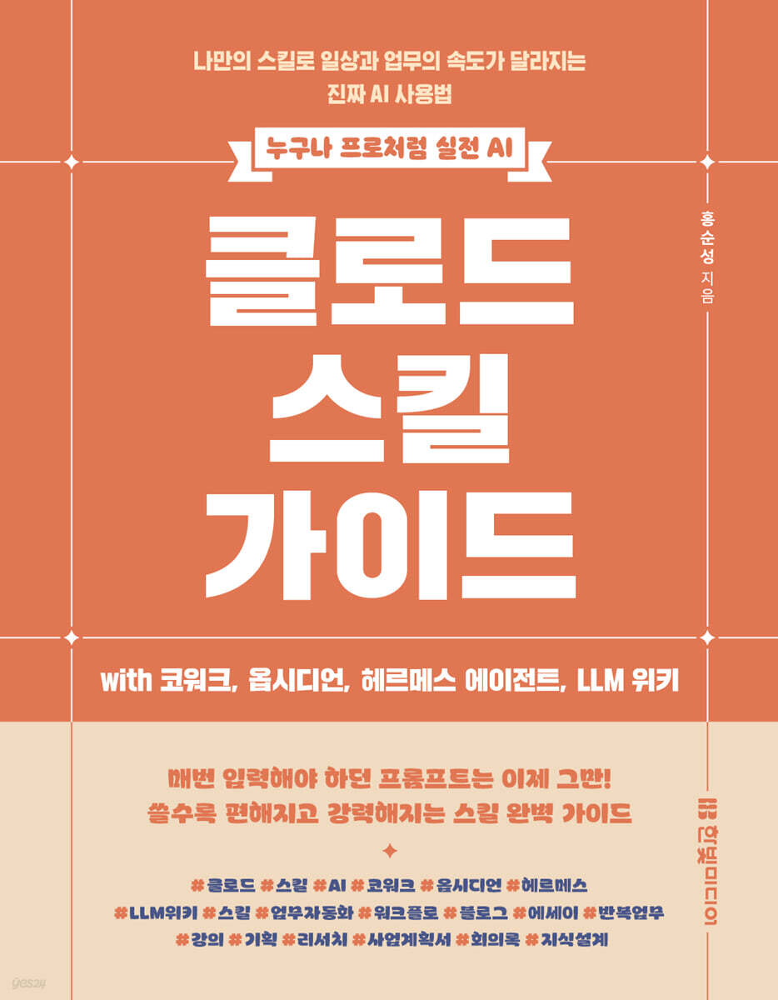

# 〈클로드 스킬 가이드 with 코워크, 옵시디언, 헤르메스 에이전트, LLM 위키〉 실습 스킬 저장소

<table>
<tr>
<td width="220" valign="top">

</td>
<td valign="top">

**클로드 스킬 가이드** 
with 코워크, 옵시디언, 헤르메스 에이전트, LLM 위키

- 저자: 홍순성(홍작가) · HONGS LAB · https://sshong.com
- 출판사: 한빛미디어
- 발행일: 2026년 11월 5일
- 쪽수: 328쪽
- ISBN: 9791175790995
- 정가: 26,000원
- 구매: [한빛미디어](https://www.hanbit.co.kr/books/%ED%81%B4%EB%A1%9C%EB%93%9C-%EC%8A%A4%ED%82%AC-%EA%B0%80%EC%9D%B4%EB%93%9C-with-%EC%BD%94%EC%9B%8C%ED%81%AC-%EC%98%B5%EC%8B%9C%EB%94%94%EC%96%B8-%ED%97%A4%EB%A5%B4%EB%A9%94%EC%8A%A4-%EC%97%90%EC%9D%B4%EC%A0%84%ED%8A%B8-llm-%EC%9C%84%ED%82%A4?code=B4151451531) · [예스24](https://www.yes24.com/product/goods/199636519) · [교보문고](https://product.kyobobook.co.kr/detail/S000221817055) · [알라딘](https://www.aladin.co.kr/shop/wproduct.aspx?ItemId=405609923)

</td>
</tr>
</table>

> [!TIP]
> **독자 단톡방: [AI 책쓰기: 집필의 기술](https://open.kakao.com/o/ghqbvP0h)** · 2,200여 명 참여 중 (2026년 11월 기준, 카카오톡 오픈채팅) 
> 스킬 설치·실행에서 막히는 부분을 질문하고, 다른 독자의 활용 사례를 나눌 수 있습니다.

매번 프롬프트를 다시 쓰는 대신, 일하는 방식을 스킬 파일 하나에 적어 두고 클로드가 그 파일을 읽고 일하게 만드는 방법을 다룬 책입니다. 스킬을 처음 등록하는 단계에서 시작해 직접 만들고 관리하는 법, 여러 스킬을 이어 책·강의 자료를 만드는 법, 옵시디언·LLM 위키·헤르메스 에이전트와 연결해 다음 작업까지 잇는 법으로 나아갑니다.

이 저장소에는 책에서 다룬 클로드 스킬 40개가 있습니다. 책을 따라 하며 스킬을 설치하고, 열어 보고, 내 작업에 맞게 고쳐 쓸 수 있습니다.

- 기준 버전: v1.0 (초판 기준)

<b>책 구성 (8개 Part, 23개 Chapter)</b>

| Part | 제목 | Chapter |
|---|---|---|
| — | 프롬프트 말고 스킬 | 00 |
| 01 | 스킬과 첫 만남 | 01~03 |
| 02 | 스킬 들여다보기 | 04~06 |
| 03 | 내 스킬 만들고 관리하기 | 07~09 |
| 04 | 스킬 하나로 결과물 하나 만들기 | 10~13 |
| 05 | 스킬 여러 개를 이어 결과물 완성하기 | 14~15 |
| 06 | 클로드와 내 컴퓨터 연결하기 | 16~17 |
| 07 | 옵시디언과 클로드로 블로그부터 책까지 쓰기 | 18~20 |
| 08 | LLM 위키와 헤르메스 에이전트로 다음 작업 이어 가기 | 21~23 |

## 이 저장소에 있는 것

| 폴더 | 내용 | 누가 쓰나 |
|---|---|---|
| `dist/` | 바로 설치하는 `.skill` 파일 40개(분류별 폴더) | 설치만 하려는 독자 |
| `skills/` | 같은 스킬의 원본 폴더(SKILL.md + 참조 파일) | 구조를 읽고 고쳐 쓰려는 독자 |
| [`INSTALL.md`](./INSTALL.md) | 설치·호출·오류 해결 | 처음 설치하는 독자 |
| [`CHANGELOG.md`](./CHANGELOG.md) | 버전별 변경 기록 | 업데이트를 확인하는 독자 |

## 3단계로 시작하기

1. **필요한 스킬만 받기**: 아래 목록에서 쓸 스킬의 **받기** 링크를 누르면 `.skill` 파일 1개가 내려받아집니다. 책에서 지금 읽는 장의 스킬부터 받습니다.
2. **등록하기**: 클로드에서 **사용자 지정 → 스킬 → + → 스킬 추가 → 스킬 업로드**를 차례로 누르고 `.skill` 파일을 올립니다.
3. **불러 쓰기**: 요청 문장에 트리거 단어를 넣거나(예: "칼럼 한 편 써 줘"), 스킬 이름을 직접 부릅니다(예: `/write-content`).

> 40개를 한꺼번에 설치하지 않기를 권합니다. 비슷한 스킬이 많이 설치되면(예: 글쓰기 스킬 7개) 요청 하나에 엉뚱한 스킬이 불려 나옵니다. 쓸 스킬만 설치하고, 안 쓰는 스킬은 사용자 지정 → 스킬에서 꺼 둡니다.

자세한 조건과 오류 해결은 [`INSTALL.md`](./INSTALL.md)에 있습니다.

## 전체 스킬 목록 (9개 분류, 40개)

"책에서 다루는 곳"은 초판 Chapter 번호입니다. "0장(소개 목록)"은 Chapter 00의 스킬 소개 표에만 나오고 본문 실습에는 쓰지 않는 스킬입니다.

### [01-writing](./skills/01-writing/) · 글쓰기 (채널·장르)

| 스킬 | 소개 | 책에서 다루는 곳 | 받기 |
|---|---|---|---|
| [write-content](./skills/01-writing/write-content/SKILL.md) | 채널을 정하지 않은 글 한 편. 모든 글쓰기 스킬의 기본형 | 4장·10장 | [write-content.skill](./dist/01-writing/write-content.skill?raw=1) |
| [write-blog](./skills/01-writing/write-blog/SKILL.md) | 워드프레스 블로그 글. 검색 유입용 소제목·내부 링크 | 2장·18장 | [write-blog.skill](./dist/01-writing/write-blog.skill?raw=1) |
| [write-naver-info](./skills/01-writing/write-naver-info/SKILL.md) | 네이버 블로그 정보글. 검색 노출·모바일 가독성 | 11장 | [write-naver-info.skill](./dist/01-writing/write-naver-info.skill?raw=1) |
| [write-facebook](./skills/01-writing/write-facebook/SKILL.md) | 페이스북 긴 글. 더보기·댓글 반응을 노린 첫 문장 설계 | 2장·9장 | [write-facebook.skill](./dist/01-writing/write-facebook.skill?raw=1) |
| [write-facebook-essay](./skills/01-writing/write-facebook-essay/SKILL.md) | 페이스북 일상 에세이. 메모를 넣으면 바로 완성(1단계) | 5장 | [write-facebook-essay.skill](./dist/01-writing/write-facebook-essay.skill?raw=1) |
| [write-brunch](./skills/01-writing/write-brunch/SKILL.md) | 브런치 글. 제목 20자·에디터 노출·연재 구성 | 9장 | [write-brunch.skill](./dist/01-writing/write-brunch.skill?raw=1) |
| [write-essay](./skills/01-writing/write-essay/SKILL.md) | 에세이 한 편. 주장보다 대상을 보는 시선부터 정함 | 12장 | [write-essay.skill](./dist/01-writing/write-essay.skill?raw=1) |

### [02-book](./skills/02-book/) · 책쓰기 체인 (실용서)

| 스킬 | 소개 | 책에서 다루는 곳 | 받기 |
|---|---|---|---|
| [book-planning](./skills/02-book/book-planning/SKILL.md) | 책 기획. 콘셉트·독자·목차 → 출판 기획서 | 14장·20장 | [book-planning.skill](./dist/02-book/book-planning.skill?raw=1) |
| [book-research](./skills/02-book/book-research/SKILL.md) | 챕터별 자료 조사. 집필 때 바로 펴 보는 참조 카드 | 14장·20장 | [book-research.skill](./dist/02-book/book-research.skill?raw=1) |
| [book-writing-pro](./skills/02-book/book-writing-pro/SKILL.md) | 실용서 챕터 집필. 작가 관점과 내 경험을 넣어 씀 | 14장·20장 | [book-writing-pro.skill](./dist/02-book/book-writing-pro.skill?raw=1) |
| [book-editing](./skills/02-book/book-editing/SKILL.md) | 원고 퇴고. 구조 → 문장 → 교정 3번에 나눠 고침 | 5장·14장·20장 | [book-editing.skill](./dist/02-book/book-editing.skill?raw=1) |
| [book-feedback-reader](./skills/02-book/book-feedback-reader/SKILL.md) | 독자 피드백. 가상 독자 3~5명이 막히는 지점 찾기 | 5장·14장 | [book-feedback-reader.skill](./dist/02-book/book-feedback-reader.skill?raw=1) |
| [book-feedback-editor](./skills/02-book/book-feedback-editor/SKILL.md) | 편집자 피드백. 콘셉트·목차·차별점·시장 리스크 진단 | 0장(소개 목록) | [book-feedback-editor.skill](./dist/02-book/book-feedback-editor.skill?raw=1) |
| [book-citation](./skills/02-book/book-citation/SKILL.md) | 출처 정리. 인용을 찾아 본문 출처와 참고문헌 작성 | 14장·20장 | [book-citation.skill](./dist/02-book/book-citation.skill?raw=1) |

### [03-novel](./skills/03-novel/) · 소설

| 스킬 | 소개 | 책에서 다루는 곳 | 받기 |
|---|---|---|---|
| [book-planning-novel](./skills/03-novel/book-planning-novel/SKILL.md) | 소설 기획. 소재·장르·인물·플롯을 정해 기획안 1쪽 | 0장(소개 목록) | [book-planning-novel.skill](./dist/03-novel/book-planning-novel.skill?raw=1) |
| [book-novel](./skills/03-novel/book-novel/SKILL.md) | 소설 본문 집필. 장면 단위로 인물·시점·대화 배치 | 0장(소개 목록) | [book-novel.skill](./dist/03-novel/book-novel.skill?raw=1) |
| [book-novel-voice](./skills/03-novel/book-novel-voice/SKILL.md) | 소설 문체 정하기. 시험 원고를 읽고 문체 규칙 작성 | 0장(소개 목록) | [book-novel-voice.skill](./dist/03-novel/book-novel-voice.skill?raw=1) |

### [04-lecture](./skills/04-lecture/) · 강의 파이프라인

| 스킬 | 소개 | 책에서 다루는 곳 | 받기 |
|---|---|---|---|
| [lecture-plan](./skills/04-lecture/lecture-plan/SKILL.md) | 강의 기획서. 대상·학습 목표·꼭지별 목차와 시간 | 15장 | [lecture-plan.skill](./dist/04-lecture/lecture-plan.skill?raw=1) |
| [lecture-research](./skills/04-lecture/lecture-research/SKILL.md) | 강의 자료 조사. 꼭지마다 사례·수치·실습 소재 정리 | 15장 | [lecture-research.skill](./dist/04-lecture/lecture-research.skill?raw=1) |
| [lecture-blueprint](./skills/04-lecture/lecture-blueprint/SKILL.md) | 슬라이드 설계. 장마다 제목·핵심 메시지를 먼저 확정 | 15장 | [lecture-blueprint.skill](./dist/04-lecture/lecture-blueprint.skill?raw=1) |
| [lecture-slides](./skills/04-lecture/lecture-slides/SKILL.md) | 슬라이드 파일(.pptx) 생성. 설계대로 만들고 발표 노트까지 | 15장 | [lecture-slides.skill](./dist/04-lecture/lecture-slides.skill?raw=1) |
| [lecture-review](./skills/04-lecture/lecture-review/SKILL.md) | 완성 슬라이드 점검. 흐름·분량·시각 자료를 보고 수정 | 15장 | [lecture-review.skill](./dist/04-lecture/lecture-review.skill?raw=1) |

### [05-research](./skills/05-research/) · 리서치

| 스킬 | 소개 | 책에서 다루는 곳 | 받기 |
|---|---|---|---|
| [research-topic](./skills/05-research/research-topic/SKILL.md) | 주제 하나 조사 → 참조 노트 1개. 기본·심화 중 선택 | 18장·21장 | [research-topic.skill](./dist/05-research/research-topic.skill?raw=1) |
| [research-mega-topic](./skills/05-research/research-mega-topic/SKILL.md) | 큰 주제 1개 → 하위 주제 10개 노트를 한 번에 생성 | 0장(소개 목록) | [research-mega-topic.skill](./dist/05-research/research-mega-topic.skill?raw=1) |
| [research-report](./skills/05-research/research-report/SKILL.md) | 조사 결과 → 남에게 낼 보고서. 5개 절 고정 양식 | 3장 | [research-report.skill](./dist/05-research/research-report.skill?raw=1) |

### [06-llm-wiki](./skills/06-llm-wiki/) · LLM Wiki

| 스킬 | 소개 | 책에서 다루는 곳 | 받기 |
|---|---|---|---|
| [wiki-research](./skills/06-llm-wiki/wiki-research/SKILL.md) | 위키용 자료 조사. 원문을 보존하고 출처를 확인 | 0장(소개 목록) | [wiki-research.skill](./dist/06-llm-wiki/wiki-research.skill?raw=1) |
| [wiki-ingest](./skills/06-llm-wiki/wiki-ingest/SKILL.md) | 자료 → 위키 페이지. 흩어진 노트를 찾아 쓰는 형태로 저장 | 21장 | [wiki-ingest.skill](./dist/06-llm-wiki/wiki-ingest.skill?raw=1) |
| [wiki-activate](./skills/06-llm-wiki/wiki-activate/SKILL.md) | 위키 → 글·강의·책 원고. 쌓아 둔 위키를 소스로 활용 | 21장·22장 | [wiki-activate.skill](./dist/06-llm-wiki/wiki-activate.skill?raw=1) |
| [wiki-audit](./skills/06-llm-wiki/wiki-audit/SKILL.md) | 위키 점검. 중복·충돌·오래된 내용 정리 | 21장 | [wiki-audit.skill](./dist/06-llm-wiki/wiki-audit.skill?raw=1) |

### [07-bizplan](./skills/07-bizplan/) · 사업계획서

| 스킬 | 소개 | 책에서 다루는 곳 | 받기 |
|---|---|---|---|
| [bizplan-research](./skills/07-bizplan/bizplan-research/SKILL.md) | 사업계획서 사전 조사. 시장·사례·자금·경쟁·내 정보 5가지 카드 | 19장 | [bizplan-research.skill](./dist/07-bizplan/bizplan-research.skill?raw=1) |
| [bizplan-kstartup](./skills/07-bizplan/bizplan-kstartup/SKILL.md) | K-Startup 사업계획서 본문(.docx). 문제·해결·성장·팀 4영역 | 19장 | [bizplan-kstartup.skill](./dist/07-bizplan/bizplan-kstartup.skill?raw=1) |
| [bizplan-kstartup-pitch](./skills/07-bizplan/bizplan-kstartup-pitch/SKILL.md) | 사업계획서 → 발표용 피치덱 17장(.pptx) | 19장 | [bizplan-kstartup-pitch.skill](./dist/07-bizplan/bizplan-kstartup-pitch.skill?raw=1) |

### [08-office](./skills/08-office/) · 실무 문서 (메일·회의록·보고)

| 스킬 | 소개 | 책에서 다루는 곳 | 받기 |
|---|---|---|---|
| [email-business](./skills/08-office/email-business/SKILL.md) | 업무 이메일. 같은 내용을 정중·중립·간결 3가지 톤으로 | 13장 | [email-business.skill](./dist/08-office/email-business.skill?raw=1) |
| [meeting-minutes](./skills/08-office/meeting-minutes/SKILL.md) | 회의 메모·녹취 → 회의록. 결정사항과 할 일·담당·기한 | 13장 | [meeting-minutes.skill](./dist/08-office/meeting-minutes.skill?raw=1) |
| [report-weekly](./skills/08-office/report-weekly/SKILL.md) | 주간 업무 보고. 한 일·할 일·이슈를 고정 양식으로 | 13장 | [report-weekly.skill](./dist/08-office/report-weekly.skill?raw=1) |
| [report-monitoring](./skills/08-office/report-monitoring/SKILL.md) | 월간 보고서. 표·수치를 현황·이슈·조치·계획 순서로 | 13장 | [report-monitoring.skill](./dist/08-office/report-monitoring.skill?raw=1) |

### [09-image](./skills/09-image/) · 이미지 (프롬프트 생성)

| 스킬 | 소개 | 책에서 다루는 곳 | 받기 |
|---|---|---|---|
| [book-cover](./skills/09-image/book-cover/SKILL.md) | 원고 → 책 표지 이미지 프롬프트. 장르별 표지 문법 반영 | 0장(소개 목록) | [book-cover.skill](./dist/09-image/book-cover.skill?raw=1) |
| [book-illustration](./skills/09-image/book-illustration/SKILL.md) | 원고 → 챕터별 삽화 프롬프트. 그림체를 한 권 안에서 통일 | 0장(소개 목록) | [book-illustration.skill](./dist/09-image/book-illustration.skill?raw=1) |
| [image-thumbnail](./skills/09-image/image-thumbnail/SKILL.md) | 블로그 원고 → 대표 이미지(썸네일) 프롬프트 | 18장 | [image-thumbnail.skill](./dist/09-image/image-thumbnail.skill?raw=1) |
| [image-infographic](./skills/09-image/image-infographic/SKILL.md) | 강의 원고 → 슬라이드용 인포그래픽 이미지 프롬프트 | 0장(소개 목록) | [image-infographic.skill](./dist/09-image/image-infographic.skill?raw=1) |

## 내 작업에 맞게 고쳐 쓰기

글쓰기 스킬의 `references/hongstyle.md`는 저자의 문체를 담은 **예시 파일**입니다. 같은 형식으로 `mystyle.md`를 만들고 SKILL.md에서 파일명을 바꾸면 내 문체로 글을 씁니다. 방법은 책 10장에 있습니다.

원본 폴더(`skills/`)를 고친 뒤에는 그 스킬 폴더를 통째로 압축(zip)해 확장자를 `.skill`로 바꾸면 다시 설치할 수 있습니다.

## 문의와 라이선스

- 스킬 오류나 설치 문제는 이 저장소의 **Issues**에 남겨 주세요.
- 사용 질문과 활용 사례는 카카오톡 오픈채팅 [AI 책쓰기: 집필의 기술](https://open.kakao.com/o/ghqbvP0h)에서 나눕니다.
- 라이선스: [LICENSE](./LICENSE) 참조
